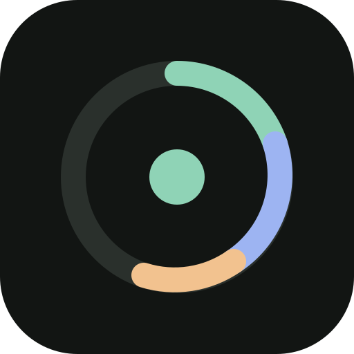
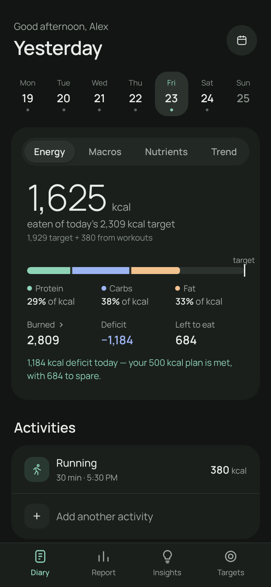
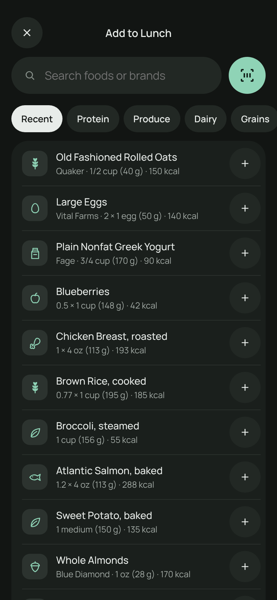
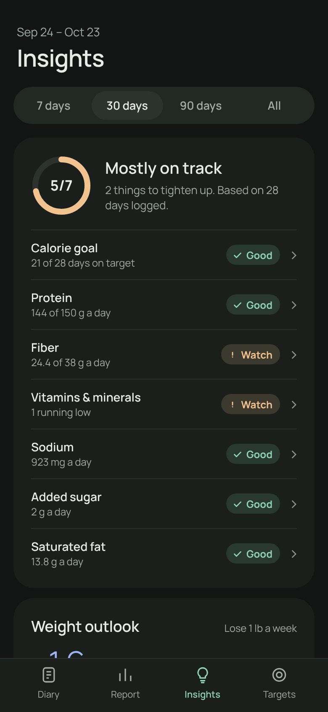
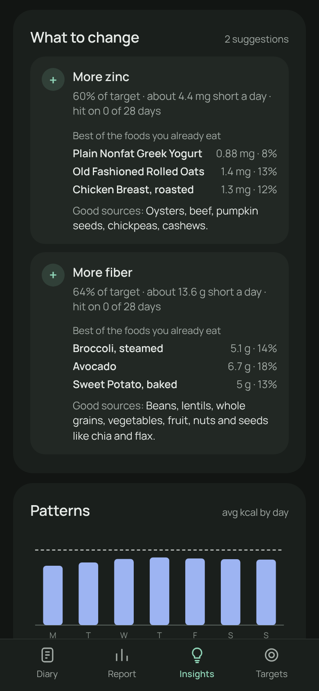

<p align="center"></p>

<h1 align="center">Spectra</h1>
<p align="center"><b>Every nutrient, label first.</b><br>A private Android food diary that tracks 90+ nutrients, shows where every number comes from, and tells you what to change.</p>

<p align="center">
  <a href="https://github.com/m0n0t0ne0ne/spectra/releases/latest/download/Spectra.apk"><b>Download the APK</b></a> ·
  <a href="https://m0n0t0ne0ne.github.io/spectra/">Website and how-tos</a> ·
  <a href="https://m0n0t0ne0ne.github.io/spectra/privacy.html">Privacy</a>
</p>

<p align="center">
  
  
  
  
</p>

## Features

- **Diary with a live summary:** energy vs. target (workouts added automatically), burned, deficit or surplus, macros, nutrient score, and weekly or monthly trend bars.
- **Custom meals:** add, rename, reorder and delete meals; swipe for menus; long-press to reorder foods.
- **Find any food:** one search box for your foods, USDA and barcode numbers; a careful barcode scanner; Ask Gemini for products no database has.
- **Sourced values:** every nutrient is tagged Label, Spec (manufacturer), Lab (USDA) or est. Small amounts are never rounded to zero.
- **Real units:** label servings, g/oz/lb, and tsp/tbsp/cup/fl oz/ml with density conversion.
- **Preview edits:** change a portion and watch the numbers update; nothing is saved until you tap Save.
- **Report:** every nutrient against Dietary Reference Intakes for your age, sex and life stage.
- **Insights:** weight outlook and rate, goal adherence (e.g. days you missed a −500 kcal deficit), scale vs. predicted weight, nutrient gaps, omega-6 : omega-3 ratio, limits, and foods to add or cut.
- **Your data:** stored only on the phone; storage meter; export or import any day, month, year or range; delete old months safely.

## Install

1. On Android 10 or newer, download [`Spectra.apk`](https://github.com/m0n0t0ne0ne/spectra/releases/latest/download/Spectra.apk) and open it.
2. Allow your browser or Files app to install unknown apps if asked, then tap **Install**.
3. Optional: verify the signing certificate (below).

Full step-by-step guides are on the [website](https://m0n0t0ne0ne.github.io/spectra/#how-to).

### Verify a download

Official builds are signed with this certificate:

```
SHA-256: D3:83:DB:A8:E0:45:83:83:64:D0:5A:D6:3C:88:00:B5:78:89:F3:67:3F:9F:F7:8B:C9:F4:B4:69:6E:4F:6E:E6
```

Check with `apksigner verify --print-certs Spectra.apk`, or compare the file with `SHA256SUMS.txt` on the release.

## Privacy

No account, no analytics, no ads. The diary, foods, weights, settings and API keys stay in the app's private storage and are excluded from Android backup. Only barcode numbers and food names you look up are sent, to Open Food Facts, USDA and (with your own key) Gemini or Claude. See the [privacy policy](https://m0n0t0ne0ne.github.io/spectra/privacy.html).

## Project layout

| Path | What it is |
|---|---|
| `web/` | The app: a dependency-free ES-module web app (HTML, CSS, JS). Runs in a browser too. |
| `android/` | Kotlin WebView shell: serves `web/` from the APK, file-backed storage, CameraX + ML Kit scanner, share target. |
| `docs/` | The GitHub Pages website, privacy policy and screenshots. |
| `tools/` | Demo data and the screenshot generator. |
| `.github/` | CI (checks every push), signed releases on tags, Dependabot. |

## Build from source

Requirements: JDK 17 and the Android SDK (platform 35).

```bash
cd android
./gradlew assembleRelease     # unsigned unless signing is configured
./gradlew assembleDebug       # installs as io.github.m0n0t0ne0ne.spectra.debug
```

The build copies `web/` into the APK automatically. To try the web app in a browser, serve `web/` with any static server, for example `python3 -m http.server -d web`.

Screenshots: `pip install playwright && python3 tools/screenshots.py`.

## Releasing

Releases are automatic: raising the number in `VERSION` and pushing to `main` makes GitHub Actions build, sign and publish the release. See [RELEASING.md](RELEASING.md) for the one-time key setup and the release checklist.

## Security

Please report vulnerabilities privately; see [SECURITY.md](SECURITY.md).

## Credits

Food data from [Open Food Facts](https://world.openfoodfacts.org) (ODbL) and [USDA FoodData Central](https://fdc.nal.usda.gov) (public domain). Third-party components are listed in [THIRD_PARTY_NOTICES.md](THIRD_PARTY_NOTICES.md).

Nutrition guidance only, not medical advice.
